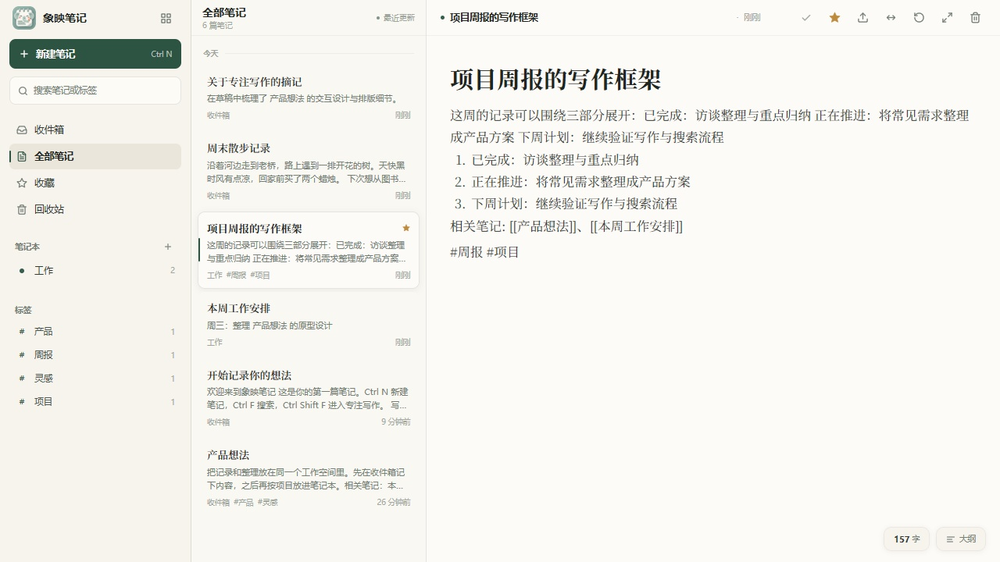
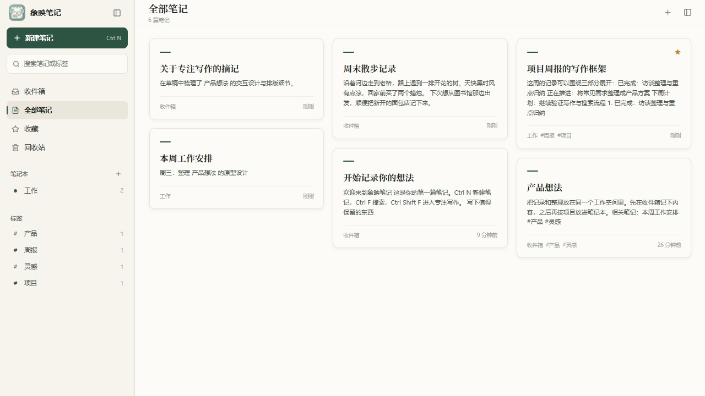
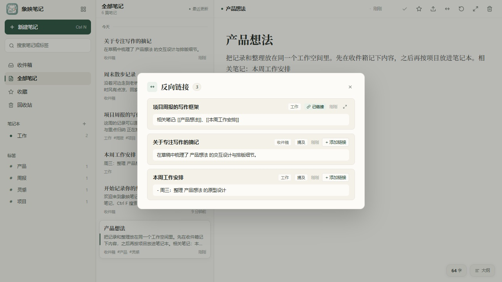
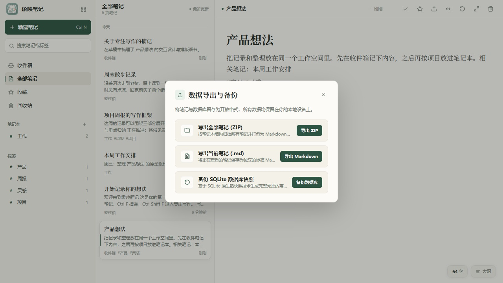

# 象映笔记 (Xiangying Notes)

让写下的每一个字，都在本地踏实落脚。

象映笔记是一款基于 **Go + MyGo 原生 GPU 自绘引擎** 与纯 Go 嵌入式 SQLite 打造的现代化桌面 Markdown 笔记软件。
彻底告别繁重的 Electron 浏览器内核与远程账号锁定，以毫秒级即时冷启动、温润典雅的宣纸质感与绝对安全的本地数据主权，让思考与书写回归宁静。

[](https://go.dev/)
[](LICENSE)
[](#-下载与安装)

---



## ✨ 用户视角与核心体验

### 1. 宣纸温润美学与沉浸书写心流

灵感不该被刺眼的纯白或塑料感的 AI 渐变打断。象映笔记选用温润的宣纸暖白（`#F4F1E9`）底色搭配松柏深绿（`#2D5342`）与墨黑点缀，衬线标题结合精致排版，提供如同纸墨相融的书写质感。

- **首段即标题**：无框大标题随文档自然滚动，首段智能提炼为标题，列表与大纲实时响应，无需反复双重输入。
- **标签随心提取**：在正文中随手书写的 `#工作`、`#读书` 标签，会自动归入左侧标签导航供随时筛选。
- **悬浮大纲与平滑跳转**：大纲抽屉随时呼出，点击标题带有平滑居中动画对齐，字数与字符统计悬浮随行。
- **输入防抖持久化**：连续编辑时调度 450ms 静止窗口防抖保存，切出或关闭时即刻刷盘，毫秒级响应并确保零数据丢失。

### 2. 瀑布流卡片网格 · 在书桌上平铺漫步灵感

列表负责严谨的线性梳理，卡片网格则负责灵感的漫步与重温。一键切入瀑布流卡片视图，所有笔记的标题、多行摘要、标签与更新时间并排铺陈，找回被遗忘在碎片里的火花。



- **原生自绘瀑布流**：纯 Go 虚拟滚动与动态高度预估算法，万篇笔记在卡片流中快速翻滚依然平滑如丝。
- **点击卡片全宽编辑**：点击任意卡片瞬间无缝过渡为全宽写作视图，收起冗余列表，专注当前的这一件事。

### 3. 双向链接与同名提及 · 让记忆网状生长

碎片记录不应是一座座孤岛。在正文任意位置输入 `[[笔记标题]]`（或 `[[标题|别名]]`）即可建立关联。



- **反向引用清晰汇集**：点击顶栏「反向链接」按钮（快捷键 `Esc` 随手收起），列出所有引用当前笔记的相关文档及上下文切片。
- **智能发现未链接提及**：系统自动扫描全库中提及当前标题但未加链接的段落，点击「+ 添加链接」一键升级为双向关联。
- **跨笔记丝滑穿梭**：在弹窗中点击笔记名称，瞬间跳转定位对应笔记，在自己的知识网络中自由漫游。

### 4. 极致克制与原生自绘 · 告别 Electron 臃肿

- **零外部运行时依赖**：无 Electron、无 Node.js、无 WebKit、无 Docker、无 CGO 外部动态链接库。
- **毫秒级冷启动**：启动耗时 < 30ms，双击瞬间立即可写，无白屏、无闪烁。
- **极低常驻内存**：日常运行仅占用数十兆（~40MB）内存，轻盈如羽毛。
- **双轨全文检索**：SQLite WAL + Trigram FTS5 + 短词散列双轨索引，即便检索单个汉字或标点符号也能瞬间匹配。

### 5. 绝对的数据主权 · 彩蛋式数据导出与热备份

数据 100% 留存在你的本地设备上，不强制注册账号，断网环境下依然具备完整功能。为了保持日常界面的纯粹，数据导出与备份做成了随手可及的彩蛋入口：



- **隐藏呼出入口**：**连续点击左上角「象映笔记」图标 5 次**（2 秒内），即可唤出「数据导出与备份」功能面板。
- **导出全部笔记为 Markdown ZIP**：按笔记本目录结构将所有有效笔记一键打包导出为完全开放的标准 Markdown 压缩包。
- **导出当前笔记 (.md)**：随时将正在查看的笔记保存为单篇独立的 Markdown 文档。
- **SQLite 原生热快照备份**：无需退出应用或手动处理 WAL/SHM 临时文件，直接基于 SQLite 原生 `VACUUM INTO` 技术生成完整、紧凑且无损的离线备份数据库（`.sqlite`）。

---

## 📦 下载与安装

前往 [GitHub Releases](https://github.com/biaobiaobiao108/xiangying-notes/releases) 获取全平台编译完成的发布包：

### Windows
- **安装包**：`xiangying-x.x.x-windows-amd64-setup.exe`。向导安装到当前用户目录，无需管理员权限，支持创建开始菜单与桌面快捷方式。
- **便携版**：`xiangying-x.x.x-windows-amd64.zip`。解压即用，无残留，方便放置在 U 盘随身携带。

### macOS (Apple Silicon)
- **安装镜像**：`xiangying-x.x.x-macos-arm64.dmg`。打开后直接将「象映笔记」拖入「应用程序」目录。
- **便携版**：`xiangying-x.x.x-macos-arm64.zip`。解压即用。

> 注：便携模式下，若当前目录下存在 `data/xiangying-notes.sqlite`，应用将优先使用该数据库；否则默认保存在系统的用户配置目录中（Windows 为 `%APPDATA%/Xiangying/`）。

---

## 🛠️ 本地构建与开发

### 环境要求
- Go 1.27+

### 构建指令
```bash
# 运行全量单元测试与无窗口 UI 模拟测试
go test -v ./...

# 编译 Windows 桌面可执行文件（无黑色命令行窗口）
go build -ldflags "-H=windowsgui" -o xiangying.exe .

# 或使用 PowerShell 脚本一键构建
pwsh -File scripts/build-windows.ps1
```

## 📄 开源许可

MIT License
